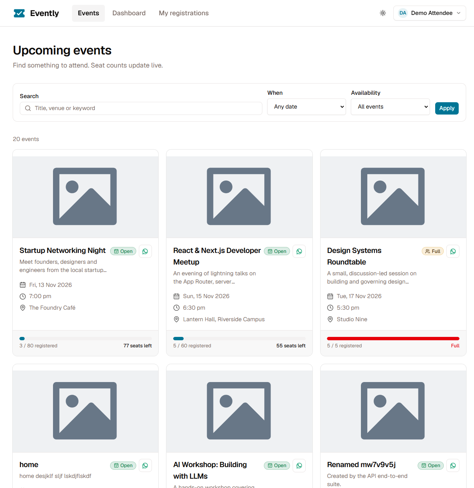
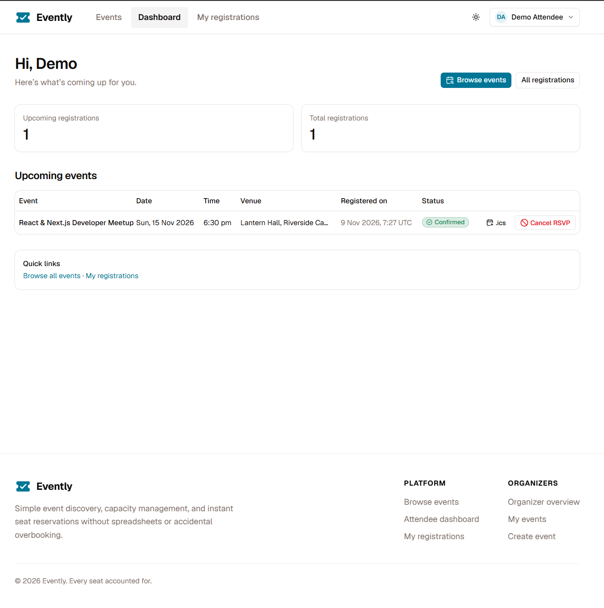
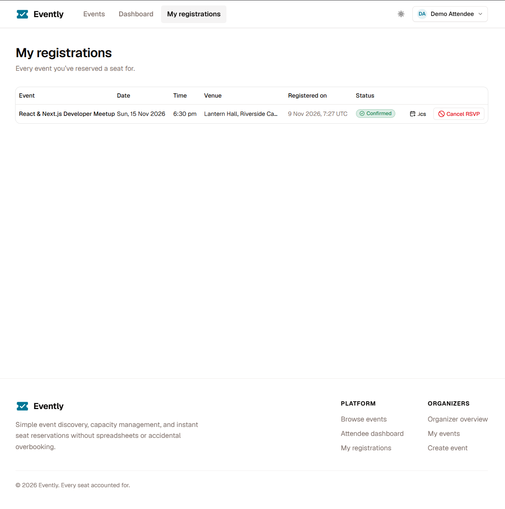
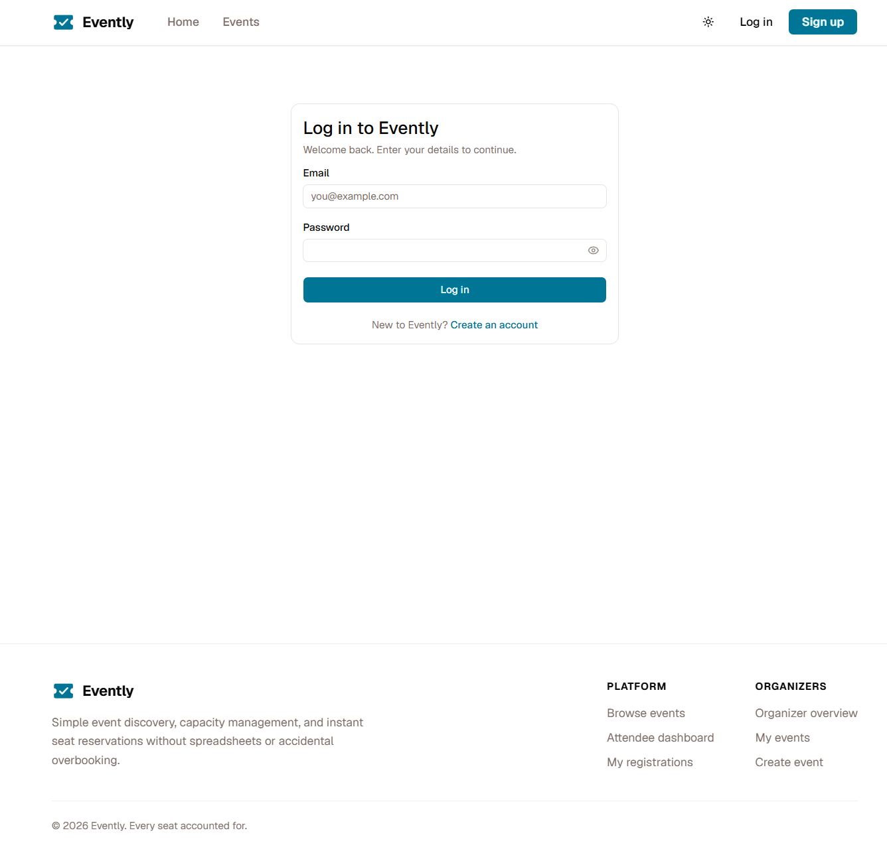
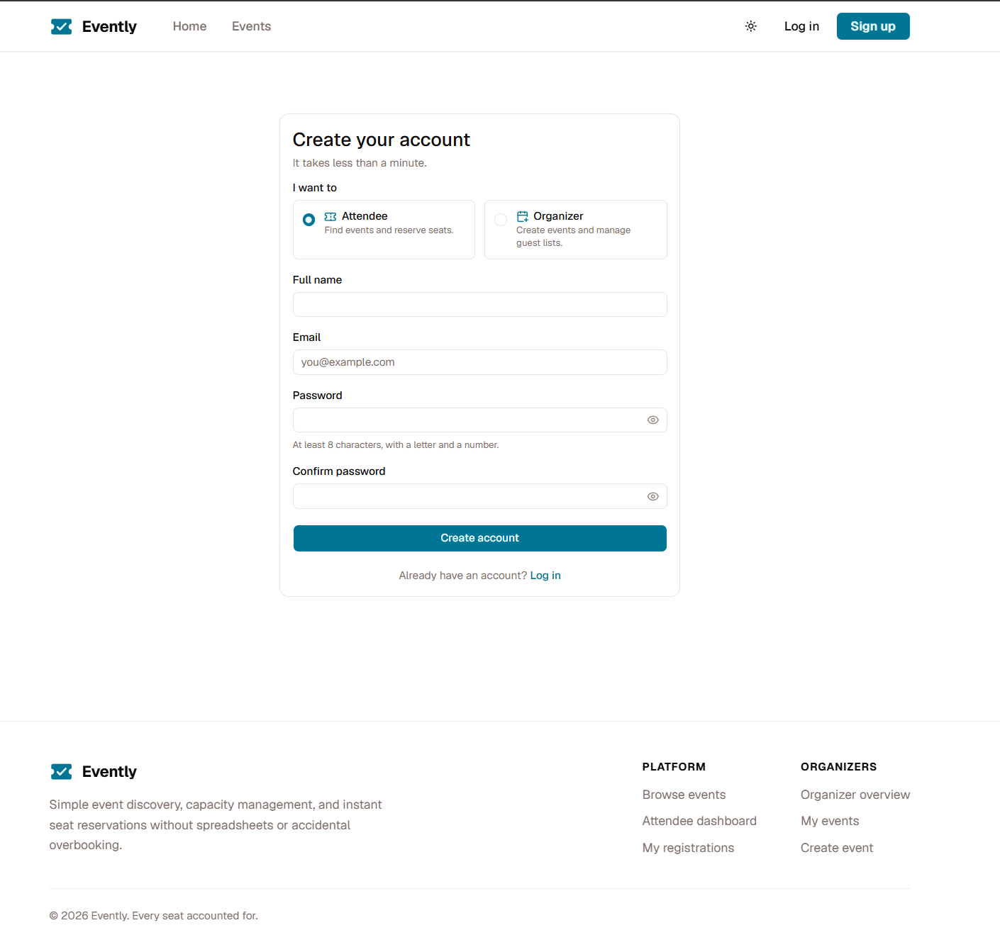
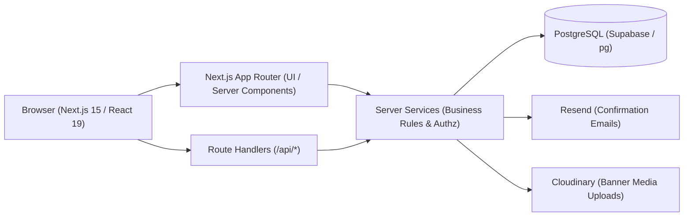

# Evently

### Event Booking & RSVP Platform

Evently is a full-stack event management and reservation platform that allows organizers to publish and manage events while attendees discover upcoming events and reserve seats. 

The application is engineered with a strict focus on backend security and data integrity:
- **Role-based access control** (Organizer and Attendee privileges enforced on Server Components and API Route Handlers)
- **Event ownership enforcement** (Organizers manage only events they created)
- **Seat-limit protection** (Atomic transactions and PostgreSQL row-level locks prevent overbooking under high concurrency)
- **Duplicate-registration prevention** (Strict database uniqueness constraints block repeat reservations)
- **Server-side validation** (All inputs validated through Zod schemas and application services)
- **Persistent PostgreSQL database** (Real-world schema with migrations, soft cancellations, and audit-ready data persistence)

---

## Live Demo

[Open Evently](YOUR_DEPLOYED_URL)

> *Note: If accessing the deployed application, replace `YOUR_DEPLOYED_URL` with the active Vercel deployment URL.*

---

## Repository

[GitHub Repository](https://github.com/PritamMahata/Evently)

---

## Demo Video

[Watch the 5-minute Demo](YOUR_DEMO_VIDEO_URL)

The walkthrough demonstrates the deployed application (not localhost) covering:
- Organizer authentication, dashboard metrics, and event creation with banner upload
- Live event management, attendee roster viewing, and CSV attendee export
- Attendee authentication, email verification flow, and event discovery with search/filters
- Instant seat reservation, atomic live capacity updates, and `.ics` calendar download
- Concurrency protection, seat-limit enforcement, and duplicate reservation prevention
- Attendee RSVP cancellation policy (allowed up to 1 day prior to the event)
- Role protection (attendees blocked from organizer actions, organizers blocked from reserving seats)

---

## Screenshots

All screenshots below are stored in [`docs/screenshots/`](docs/screenshots/):

### Homepage & Live Monitor


### Event Discovery & Filters


### Organizer Dashboard & Analytics


### Attendee Registrations & Management


### Authentication: Login & Signup



---

## Project Overview

Evently provides dedicated workflows tailored to each user role:

### Organizer
- **Create events**: Publish events with title, description, date, time, venue, seat limit, and custom banner imagery.
- **Edit events**: Update event details, dates, or venues; increase capacity, or adjust seat limits (validated so limits cannot fall below existing registrations).
- **Cancel events**: Soft-cancel events, halting new registrations while preserving attendee history for records.
- **Set seat limits**: Configure strict seating capacities for venues of any size.
- **View registrations & live capacity**: Monitor real-time seat counts and percentage capacity utilization.
- **Export attendee data**: Download complete attendee rosters as sanitised CSV files.

### Attendee
- **Browse upcoming events**: Explore active events presented in a responsive card grid.
- **Search & filter events**: Filter events by keyword (title, description, venue), date timeframe (*Today*, *This Week*, *This Month*), and seat availability.
- **View event details**: Access rich event pages featuring 21:9 hero banners, venue logistics, host identity, and live seat meters.
- **Register for events**: Reserve a guaranteed seat with one click through atomic database transactions.
- **Cancel RSVP**: Cancel reservations up to 1 day (24 hours) before the event begins, automatically releasing the seat for other attendees.
- **View registrations**: Manage all reserved seats in a unified dashboard table or mobile card view.
- **Export events to calendar**: Download standard `.ics` iCalendar files to add events to Google Calendar, Apple Calendar, or Outlook.
- **Verify email**: Verify account email addresses via single-use 24-hour verification tokens.

---

## Core Features

- **Authentication & Authorization**: Secure email/password login and registration with bcrypt-12 password hashing, opaque session tokens, and strict HTTP-only cookies.
- **Email Verification**: Token-based email verification using SHA-256 token hashing and Resend transactional email delivery.
- **Role-Based Access Control (RBAC)**: Clear privilege separation between `ORGANIZER` and `ATTENDEE` enforced at both middleware/layout and API levels.
- **Event Lifecycle Management**: Full CRUD operations for events with soft cancellation that preserves registration history.
- **Event Ownership Enforcement**: Organizers can only edit, cancel, view attendees, or export data for events they personally created.
- **Atomic Concurrency & Overbooking Protection**: `SELECT ... FOR UPDATE` database row locking paired with PostgreSQL constraint triggers guarantees seat limits are never exceeded even under simultaneous concurrent requests.
- **Duplicate-Registration Prevention**: Compound unique constraint `UNIQUE(event_id, attendee_id)` blocks repeat registrations with friendly error messaging.
- **Attendee RSVP Cancellation**: Attendees can self-serve cancel RSVPs up to 1 day (24 hours) prior to event start time, immediately restoring seat availability.
- **Search & Multi-Parameter Filters**: Dynamic search across titles, descriptions, and venues with timeframe and availability filters.
- **Organizer Dashboard & Metrics**: Consolidated overview of total events, attendees, and seat utilisation with visual progress meters.
- **CSV Attendee Export**: One-click attendee roster download formatted to RFC 4180 with spreadsheet formula-injection defenses.
- **iCalendar (.ics) Integration**: Standard calendar file generation for confirmed attendees.
- **Event Banner Uploads**: Cloudinary media upload integration with drag-and-drop file picker, preset themes, and fallback placeholder graphics.
- **Direct WhatsApp Event Sharing**: Instant 1-click sharing preformatted with bold event titles, dates, venues, remaining capacity, and direct links.
- **Accessibility & Dark Mode**: Semantic HTML, ARIA landmarks, keyboard focus rings, and complete light/dark theme toggle powered by `next-themes`.
- **Defensive Security Hardening**: CSRF origin validation, sliding-window rate limiting, and 100% parameterized SQL queries.

---

## Bonus Features Implemented

1. **Search & Multi-Parameter Filtering** — Attendees can search events by keyword and filter simultaneously by date range (*Today*, *This Week*, *This Month*) and seat availability.
2. **Organizer Dashboard & Analytics** — A dedicated overview at `/organizer` displaying total active events, cumulative attendees, and live seating utilization meters.
3. **CSV Export with Injection Protection** — Organizers can export attendee lists to CSV with automatic defense against spreadsheet formula injection (`=`, `+`, `-`, `@`).
4. **Add to Calendar (.ics) Export** — Attendees can download standard `.ics` calendar files directly from the event detail page or their registration dashboard.
5. **Banner Image & Media Uploads** — Drag-and-drop banner image uploader powered by Cloudinary, complete with theme presets and responsive aspect ratios.
6. **Email Confirmation** — Database-backed email verification using single-use SHA-256 tokens and Resend transactional email dispatch.
7. **Direct WhatsApp Event Sharing** — Preformatted WhatsApp share button that compiles event title, schedule, venue, and live seat count into a shareable invite link.
8. **Accessibility & Dark Mode** — Contrast-compliant dark/light theme switching with accessible dialogs, alerts, and keyboard navigation.
9. **Defensive Security Hardening** — Row-level database locks, native PostgreSQL triggers, bcrypt-12 hashing, sliding-window login rate limiting, and security headers.

---

## Tech Stack

### Frontend
- **Next.js** `15.5.29` (App Router, Server Components, Route Handlers)
- **React** `19.3.1` & **React DOM** `19.3.1`
- **TypeScript** `6.0.3`
- **Tailwind CSS** `4.3.5` (Modern engine, CSS variables)
- **UI & Icons**: Base UI (`^1.9.0`), Radix UI primitives (`^1.8.1`), Lucide React (`^1.70.0`)
- **Animations**: Motion (`^14.10.1`), GSAP (`^3.15.1`)
- **Forms & Validation**: React Hook Form (`^7.91.0`) with Zod (`^4.6.7`) resolver
- **Toasts & Theming**: Sonner (`^2.0.8`), next-themes (`^0.4.6`)

### Backend
- **Next.js Route Handlers** (`/api/*`) and **React Server Components**
- **Centralised Service Layer** (`src/server/services/*`) ensuring identical business rule validation across API and UI
- **node-postgres (`pg`)** `8.23.1` with native connection pooling

### Database
- **PostgreSQL** (Hosted via Supabase Database)
- Native SQL migration files (`db/migrations/*.sql`) executed via custom migration runner
- Row-level transactions (`SELECT ... FOR UPDATE`) and PL/pgSQL constraint triggers

### Authentication System (Custom, Not Supabase Auth)
> **Important Implementation Detail**: Evently uses a custom, self-hosted authentication architecture rather than Supabase Auth or third-party auth vendors.
- **Passwords**: Hashed with bcrypt (work factor 12) via `bcryptjs` `^3.0.3`.
- **Sessions**: Cryptographically secure 256-bit random tokens; stored as SHA-256 hashes in the PostgreSQL `sessions` table.
- **Cookies**: Transmitted exclusively via HTTP-only, SameSite=Lax, Secure cookies.
- **Rate Limiting**: Database-backed sliding-window rate limiting on login attempts (keyed by HMAC-SHA256 of IP and email).

### Third-Party Services
- **Resend** `^6.37.0` (Transactional email dispatch for email confirmations)
- **Cloudinary** `^2.11.0` (Secure image storage, transformations, and banner hosting)
- **Vercel** (Serverless hosting platform)

---

## Architecture



All application logic is unified inside `src/server/services/*`. Both the API routes and server-rendered pages call these exact services, ensuring authorization rules, seat limits, and validation checks cannot be bypassed by accessing alternative entry points.

Detailed documentation: [`docs/ARCHITECTURE.md`](docs/ARCHITECTURE.md).

---

## Database Schema

The database relies on plain SQL migrations executed via `npm run db:migrate`:

| Table | Purpose |
|-------|---------|
| `users` | User profiles, role (`ORGANIZER` or `ATTENDEE`), bcrypt password hash, and `email_confirmed_at` timestamp |
| `sessions` | Active user sessions, storing SHA-256 session token hashes and expiration timestamps |
| `email_confirmations` | Single-use SHA-256 token hashes, user foreign keys, and 24-hour expiration dates for email verification |
| `login_attempts` | Sliding-window brute-force defense keys (`HMAC-SHA256(email, ip)`) and attempt counters |
| `events` | Event records with organizer reference, title, description, date, time, venue, seat limit, status (`ACTIVE` / `CANCELLED`), and `banner_url` |
| `registrations` | Attendee reservations constrained by `UNIQUE(event_id, attendee_id)` with concurrency triggers |

Detailed documentation: [`docs/DATABASE.md`](docs/DATABASE.md).

---

## Business Rules

| # | Business Rule | Enforcement Mechanism |
|---|---------------|-----------------------|
| 1 | **Seat limits cannot be exceeded** | Row-level locking (`SELECT ... FOR UPDATE`) in `registerForEvent` + PostgreSQL `BEFORE INSERT` trigger `enforce_registration_rules` |
| 2 | **One registration per attendee per event** | Database constraint `UNIQUE(event_id, attendee_id)` paired with friendly HTTP 409 response |
| 3 | **Organizers manage only their own events** | Server-side ownership verification (`assertOwner`) on event edit, cancellation, attendee viewing, and CSV export |
| 4 | **Events must be scheduled in the future** | Server-side clock check in application timezone (`isFuture`) preventing creation of past events |
| 5 | **Past or cancelled events cannot be registered for** | Server-side status checks in `registerForEvent` + DB trigger rejecting inserts for non-active events |
| 6 | **Seat limit cannot drop below existing registrations** | Locked count check in `updateEvent` + PostgreSQL `BEFORE UPDATE` trigger `enforce_seat_limit_change` |
| 7 | **Attendee RSVP cancellation cutoff** | Allowed up to 1 day (24 hours) prior to event start time (`cancelRsvp`); rejected if within 24 hours or past |
| 8 | **Role privilege separation** | Server-side guards (`requireRole`) ensuring organizers cannot reserve seats and attendees cannot create/edit events |

---

## Security

- **Bcrypt Password Hashing**: Passwords hashed with work factor 12; raw passwords never saved or logged.
- **Secure Sessions**: 256-bit opaque session tokens stored exclusively as SHA-256 hashes in the database; delivered via HTTP-only, SameSite=Lax cookies.
- **Server-Side Authorization**: Every mutation verifies session authenticity and role permissions on the server.
- **Event Ownership Checks**: Resource mutations require direct organizer ownership verification before executing.
- **Parameterized Queries**: 100% of database queries use parameterized SQL (`$1, $2, ...`), eliminating SQL injection vulnerabilities.
- **Input Validation**: Strict Zod schemas validate all request payloads, search parameters, and URL route parameters.
- **CSRF & Origin Verification**: State-changing requests enforce same-origin verification against the configured `APP_URL`.
- **Brute-Force Rate Limiting**: DB-backed sliding window rate limits repeated failed login attempts (5 attempts per 15 minutes).
- **Single-Use Verification Tokens**: Email confirmation tokens are hashed (SHA-256) with strict 24-hour expiration.
- **CSV Injection Defense**: Formula triggers (`=`, `+`, `-`, `@`) in attendee names and emails are prepended with an apostrophe during CSV generation.
- **Media Upload Validation**: File uploads enforce MIME type checks (PNG, JPG, WebP, AVIF), 5MB size limits, and isolated Cloudinary storage.
- **Security Headers**: Production headers include `X-Content-Type-Options: nosniff`, `X-Frame-Options: DENY`, `Referrer-Policy: strict-origin-when-cross-origin`, and restricted `Permissions-Policy`.

---

## Local Development

### Prerequisites
- **Node.js**: Version `20.x` or higher
- **PostgreSQL**: Version `13+` (Local Postgres or Supabase connection)

### Setup Instructions

1. **Clone the repository**:
   ```bash
   git clone https://github.com/PritamMahata/Evently.git
   cd Evently
   ```

2. **Install dependencies**:
   ```bash
   npm install
   ```

3. **Configure environment variables**:
   ```bash
   cp .env.example .env.local
   ```
   *Edit `.env.local` to provide your PostgreSQL connection strings and secrets.*

4. **Run database migrations**:
   ```bash
   npm run db:migrate
   ```

5. **Seed demo data (Optional but recommended)**:
   ```bash
   npm run db:seed
   ```

6. **Start development server**:
   ```bash
   npm run dev
   ```
   Open [http://localhost:3000](http://localhost:3000) in your browser.

---

## Environment Variables

| Variable | Purpose | Required |
|----------|---------|:--------:|
| `DATABASE_URL` | PostgreSQL connection string (Transaction pooler on port 6543 for serverless runtime) | **Yes** |
| `DIRECT_URL` | Direct PostgreSQL connection string (Port 5432, used for migrations and seeding) | Optional |
| `DATABASE_SSL` | Set to `"true"` for remote SSL/TLS database connections (e.g. Supabase) | **Yes** |
| `AUTH_SECRET` | 32-byte secret string used to hash login rate-limit keys (`openssl rand -base64 32`) | **Yes** |
| `APP_TIMEZONE` | IANA timezone for event date/time operations (e.g. `UTC`, `Asia/Kolkata`) | **Yes** |
| `APP_URL` | Public site URL for CSRF origin checks and email links (e.g. `http://localhost:3000`) | **Yes** |
| `RESEND_API_KEY` | Resend API key for sending confirmation emails | Optional |
| `RESEND_FROM_EMAIL` | Verified sender address (e.g. `Evently <onboarding@resend.dev>`) | Optional |
| `CLOUDINARY_URL` | Cloudinary connection URI (`cloudinary://<key>:<secret>@<cloud_name>`) | Optional |
| `CLOUDINARY_CLOUD_NAME` | Cloudinary cloud identifier for event banner media storage | Optional |
| `CLOUDINARY_API_KEY` | Cloudinary API Key | Optional |
| `CLOUDINARY_API_SECRET` | Cloudinary API Secret | Optional |

> **Important**: `.env.example contains placeholder values only. Real environment variables must never be committed to Git.`

---

## Demo Accounts

The database seed (`npm run db:seed`) provides the following fictional evaluation accounts:

| Role | Email | Password | Purpose |
|------|-------|----------|---------|
| **Organizer** | `demo.organizer@example.com` | `DemoOrganizer123` | Primary organizer account (owns seeded events) |
| **Organizer (Secondary)** | `second.organizer@example.com` | `DemoOrganizer123` | Second organizer for verifying ownership isolation |
| **Attendee** | `demo.attendee@example.com` | `DemoAttendee123` | Attendee account for browsing, registering, and cancelling |

> *Note: These credentials are strictly throwaway evaluation accounts for demonstration purposes.*

---

## Testing & Verification

The repository contains an automated test suite using Vitest along with TypeScript and ESLint verification scripts:

```bash
# Run Vitest test suite (41/41 passing integration tests)
npm test

# Verify Next.js production build and static page generation
npm run build

# Run TypeScript typecheck compiler (tsc --noEmit)
npm run typecheck

# Run ESLint check
npm run lint

# Verify matrix of core business requirements
npm run verify:requirements

# Comprehensive preflight check (lint + typecheck + tests + secret scan)
npm run preflight
```

### Verified Test Results
- **Authentication**: 10 tests passing (signup, bcrypt hashing, case-insensitive duplicate email rejection, login credentials, rate limiting, token generation, email verification).
- **Events Management**: 11 tests passing (organizer event creation, attendee edit/cancel blocks, past date rejections, ownership isolation, cancellation state preservation, banner URL updates).
- **Registrations & Concurrency**: 20 tests passing (single seat registration, duplicate blocking via service and DB constraint, overbooking protection with 25 parallel attempts for 3 seats, DB triggers, seat limit changes, `.ics` calendar generation, RSVP cancellation cutoff rules).

---

## Deployment

- **Application Hosting**: Deployed on **Vercel** utilizing Next.js 15 App Router and serverless Route Handlers.
- **Database**: Hosted on **Supabase PostgreSQL** utilizing connection poolers for serverless functions.
- **Media & Emails**: External media served via **Cloudinary CDN**; transactional verification emails sent via **Resend**.
- **Production URL**: `YOUR_DEPLOYED_URL` *(Configured in Vercel project settings with matching `APP_URL` environment variable).*

---

## Demo Data & Secrets

### Demo Data
All names, email addresses, event records, and account credentials used for evaluation are fictional/demo data.

### Secrets
No production API keys, passwords, database credentials, or private secrets are committed to the repository. `.env` and local environment files are excluded from Git, while `.env.example` contains placeholders only.

---

## Known Limitations

- **Single Configured Timezone**: Event dates and times are interpreted within the configured server timezone (`APP_TIMEZONE`).
- **Calendar Event Duration**: `.ics` export assigns a default 2-hour duration to events that do not specify a separate end time.
- **Resend Free Tier Restrictions**: On unverified domains, Resend sandbox policies restrict email delivery to the registered developer email address until custom domain DNS records are configured.

---

## Future Improvements

- **Automated Waitlists**: Automatically promote attendees from a waitlist when an active reservation is cancelled.
- **Multi-Timezone Support**: Dynamic timezone conversion displaying events in each attendee's local device timezone.
- **Location-Based Discovery**: Radius-based search and map views for discovering local in-person events.
- **Payment Processing**: Stripe integration supporting paid ticket tiers alongside free registrations.
- **Recurring Events**: Support for weekly, bi-weekly, or monthly recurring event series.
- **QR-Code Ticket Check-In**: Dynamic QR code generation on attendee tickets with a camera check-in scanner for organizers.
- **Event Reminders**: Automated email notifications dispatched 24 hours prior to event start.
- **Advanced Organizer Analytics**: Detailed attendee registration velocity charts and referral source tracking.

---

## Project Structure

```
evently/
├── db/
│   └── migrations/                  # Plain SQL migration files
├── docs/
│   ├── screenshots/                 # Application screenshots
│   ├── ARCHITECTURE.md              # Architectural decisions and data flow
│   ├── DATABASE.md                  # Comprehensive database schema reference
│   ├── DEMO_VIDEO_SCRIPT.md         # Video demonstration script
│   ├── DEPLOYMENT.md                # Deployment walkthrough
│   └── REQUIREMENTS.md              # Matrix of business requirements
├── public/                          # Static assets and placeholders
├── scripts/                         # Database migration, seed, and preflight scripts
├── src/
│   ├── app/                         # Next.js App Router (pages and API routes)
│   ├── components/                  # React UI components (home, events, organizer, dashboard)
│   ├── hooks/                       # Client-side custom hooks
│   ├── lib/                         # Shared utilities, auth, database pool, and validation
│   ├── server/                      # Server-side business logic and services
│   └── types/                       # TypeScript definitions and interfaces
├── tests/                           # Vitest integration test suites
├── .env.example                     # Environment variable template
├── .gitignore                       # Git exclusions
├── package.json                     # Project manifest and scripts
├── tsconfig.json                    # TypeScript compiler configuration
└── README.md                        # Project documentation
```
